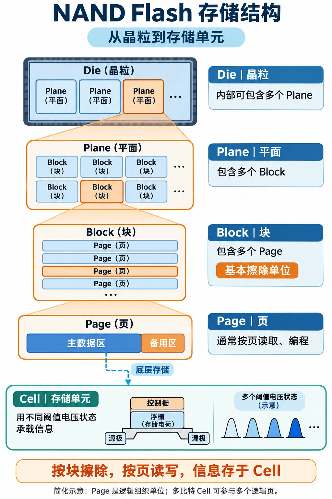

Day2：NAND 组织结构与读、写、擦除流程

# 一、今天要解决什么问题
Day1 中，我们创建过这样的请求：

```c
NandRequest req1 = {101, 256, 0, REQ_PENDING};
```

你已经知道如何将它复制入队、出队，以及通过指针修改状态。今天继续回答：

1. `page = 256` 到底指哪里？与 RAM 地址有什么区别？
2. Page、Block、Plane、Die 分别是什么？
3. 为什么不能像修改普通数组那样，直接覆盖 NAND 上的数据？
4. 一次读取为什么既有 NAND 完成事件，又有 ECC 结果？
5. 如何在 C 语言中将页号换算为块号和块内页号？

学完后，你应该能把 Day1 中的“请求队列”与实际 NAND 读写过程连接起来。

---

# 二、从请求中的 page 认识 NAND
## 2.1 page 是存储位置编号，不是 C 指针
```c
uint32_t page = 256;
NandRequest *p = &req1;
```

这两个概念需要分开：

| 内容 | 含义 | 用途 |
| --- | --- | --- |
| `page = 256` | 教学模型中 NAND 的物理页编号 | 告诉后端读取哪一页 |
| `p = &req1` | 请求结构体在 CPU 可访问内存中的地址 | 让 C 函数访问请求字段 |
| 数据缓冲区地址 | 接收或提供数据的 RAM 地址 | 保存读出的数据或准备写入的数据 |


**请求对象放在 RAM 中，请求里的页号描述 NAND 中的位置。**

例如，`p->page` 是通过 RAM 中的结构体读取“256”这个数，并不是直接访问 NAND 第 256 页。

真实后端还需要 Channel、目标芯片、LUN/Die、Plane 等信息；Day1 只用一个 `page` 字段，是为了先学习 C 和队列。今天仍限定在一个固定存储目标内编号。

## 2.2 NAND 的组织层级
先按下面的简化模型理解：

| 层级 | 中文理解 | 与下一级的关系 |
| --- | --- | --- |
| Die | 晶粒 | 内部可包含多个 Plane |
| Plane | 平面 | 包含多个 Block |
| Block | 块 | 包含多个 Page，是基本擦除单位 |
| Page | 页 | 包含主数据区和备用区 |
| Cell | 存储单元 | 用不同阈值电压状态承载信息 |


表中是学习用层级。实际芯片封装可以包含多个 Die，LUN 与 Die 的关系、Plane 选择方式及并行操作限制要查具体手册，不能仅凭这张表推断。

**Channel 是控制器与 NAND 通信的通道，不是 Page 内部的一个存储层级**。同一通道可能连接多个目标，共享总线，因此多个 Die 不代表数据总线可以无限并行传输。



## 2.3 假设参数
| 参数 | 假设值 |
| --- | --- |
| 每页主数据区大小 | 2,048 字节，即 2 KiB |
| 每页备用区大小 | 64 字节 |
| 每块页数 | 64 页 |
| 总块数 | 1,024 块 |
| 编号起点 | 从 0 开始 |


由此得到：

+ 每块主数据容量：`2048 × 64 = 131072 B = 128 KiB`。
+ 总页数：`64 × 1024 = 65536`。
+ 总主数据容量：`2048 × 64 × 1024 = 134217728 B = 128 MiB`。
+ 合法页号：`0～65535`。

这里没有把备用区计入主数据容量，也没有扣除坏块、保留空间等因素，不能直接当成最终主机可用容量。

---

# 三、Page 与 Block
## 3.1 Page：读写操作的主要组织单位
一页通常包括：

| 区域 | 英文 | 常见用途 |
| --- | --- | --- |
| 主数据区 | Main Area | 存储有效数据 |
| 备用区 | Spare Area / OOB | 按具体设计保存 ECC 校验信息、元数据、坏块标记等 |


OOB 是 **Out Of Band**。备用区不是可以随意使用的额外空间：ECC 布局、坏块标记位置、片内 ECC 模式等都可能限制其用途。

ECC 的计算单位也不一定是一整页。例如，一页可能分成多个 ECC 码字分别保护。今天只把最终解码结果简化为“可恢复”或“当前读取不可恢复”。

## 3.2 Block：擦除单位
用今天的配置举例：

| 块号 | 包含的全局物理页号 |
| --- | --- |
| Block 0 | 0～63 |
| Block 1 | 64～127 |
| Block 2 | 128～191 |
| Block 3 | 192～255 |
| Block 4 | 256～319 |
| Block 8 | 512～575 |


因此，Day1 中的 `page=256`，在今天的模型里对应：**第 4 块中的第 0 页**。

它不是“第 256 块”，也不是“字节地址 256”。

## 3.3 地址换算公式
设：

+ `P`：固定存储目标内，从 0 开始的全局物理页号。
+ `N`：每块页数。
+ `B`：块号。
+ `I`：块内页号。

换算关系为：

```c
B = P / N;
I = P % N;
P = B * N + I;
```

例如 `P=258`、`N=64`：

```latex
block = 258 / 64 = 4
page_in_block = 258 % 64 = 2
反向验证：4 × 64 + 2 = 258
```

这与 Day1 的取模操作有联系：队列用 `% QUEUE_SIZE` 实现索引回绕，这里用 `% PAGES_PER_BLOCK` 得到块内页号。运算相同，业务含义不同。

## 3.4 Column、Row 与今天的页号有什么关系
+ **Column（列地址）**：选择页数据寄存器中的位置；具体单位与 x8/x16 接口等有关。
+ **Row（行地址）**：用于选择阵列中的页，涉及块号、块内页号以及器件规定的其他地址位。

今天的 `page` 是软件教学模型中的线性编号。实际发送几个地址周期、哪些位选择 Plane/LUN，要按器件规范编码，不能直接把 C 结构体原样发给 NAND。

---

# 四、读、写、擦除
## 4.1 三种操作对照
| 操作 | 英文 | 主要作用 | 基本粒度与约束 |
| --- | --- | --- | --- |
| 读取 | Read | 将已有数据取回 | 阵列读取通常以页组织，输出可按允许的范围进行 |
| 编程/写入 | Program | 将准备好的数据写进 NAND | 通常按页组织；部分编程、页顺序等受器件限制 |
| 擦除 | Erase | 使一个块恢复到可重新编程的擦除状态 | 以块为单位，影响块内所有页 |


先记住：**读写看页，擦除看块**。这是一条学习主线，具体合法操作仍以数据手册为准。

## 4.2 读取流程：完成传输后还要判断数据能否恢复
一次基础读取可以分为：

1. 固件从待处理队列取出请求，确认读取目标。
2. 下发读取命令、地址及确认命令。
3. 等待 NAND 将阵列内容读到内部页数据寄存器。
4. 将数据传输到控制器/RAM 缓冲区。
5. 根据 ECC 解码结果判断数据是否可用。
6. 成功则完成请求；当前结果不可纠正时，按策略尝试重读或报告失败。

实际控制器可能边传输边解码，步骤存在重叠。这里按逻辑依赖拆开，方便分析。

**NAND 内部读取结束、数据传输结束、ECC 解码成功、上层请求成功，是不同的完成条件**。日志中的 `READ_DONE` 必须结合该项目对事件的定义理解。

**ECC 三种结果**

| 结果 | 含义 | 后端可能采取的动作 |
| --- | --- | --- |
| 无需纠错 | 没有检测到需要纠正的位错误 | 返回数据 |
| 纠错成功 | 存在错误，但在当前解码能力内恢复 | 返回数据，可记录纠错统计 |
| 当前解码不可纠正 | 当前读取及解码条件下无法恢复 | 尝试重读、其他恢复策略，或最终报错 |


**纠错成功也是成功读取，不需要因为出现过位错误就一律重读。**

## 4.3 Read Retry 为什么可能有效
NAND 通过感知存储单元的阈值电压状态来恢复信息。磨损、保持时间及干扰等因素可能让判断变得困难。

Read Retry 通常会按器件支持的方式调整读取相关参数，例如参考电压，再重新读取并解码；具体步骤和支持能力依赖芯片。

Day1 中只有：

```c
current.retry_count++;
```

这只是在 RAM 中更新次数。真实重读还要执行参数设置、重新发起读取、重新传输/解码及结果判断，必要时恢复读取配置。

“再读同一页”不等于“保证能够恢复”。必须有重试上限和最终失败出口。

## 4.4 写入流程：写入数据之后要检查状态
一次基础编程可以理解为：

1. 准备主数据、所需 ECC 信息及元数据。
2. 选择满足编程规则的目标页。
3. 下发编程命令、地址，将数据送入 NAND 数据寄存器。
4. 下发编程确认命令，启动内部编程。
5. 等待器件就绪。
6. 读取并检查编程状态，再决定成功或错误处理。

ECC 由控制器、片内模块还是软件生成，取决于设计；今天不实现 ECC 算法。

**数据已经送到 NAND，并不意味着内部编程已经成功。器件重新就绪，也不能代替成功状态检查。**

## 4.5 为什么不能直接覆盖旧数据
以常见 SLC 的逻辑抽象理解：擦除后的位通常读作 `1`，编程将需要的位变成 `0`；要使已编程的 `0` 回到擦除态 `1`，需要擦除。

例如：

```latex
旧数据：0x00 = 00000000
新数据：0xFF = 11111111
```

不能像 RAM 那样，直接赋值就完成这种覆盖。

MLC/TLC/QLC 涉及更多阈值电压状态和编程约束。上述位模型用于帮助入门；即使某次变化只涉及 `1→0`，也不意味着同一页可以任意多次编程。

## 4.6 擦除流程：影响的是整块
1. 选择目标块，并确认其中需要保留的数据已安全迁移。
2. 下发块擦除命令、地址及确认命令。
3. 等待器件内部擦除结束。
4. 读取并检查擦除状态。
5. 成功后按管理策略使用该块，失败则进入错误处理。

**如果要更新 Page 258，却直接擦除 Block 4，那么 Page 256～319 原有内容都会受影响。**

存储系统通常把新数据写到新的可用位置，再更新映射，使旧位置成为无效数据；后续回收时迁移仍然有效的数据，再擦除旧块。这是后续学习 FTL 和垃圾回收的入口。

不要把“每次写页前都擦一次块”当成正确规则：一个已经擦除且满足编程规则的块，可以按要求继续编程尚未使用的页。

---

# 五、把 Day1 的队列接到 NAND 后端
## 5.1 四个字段分别负责什么
| Day1 字段 | 今天的解释 |
| --- | --- |
| `id` | 标识请求，用于串联日志；不是 NAND 地址 |
| `page` | 固定目标内的物理页编号，进一步解析为块号和块内页号 |
| `retry_count` | 记录已发起的重读次数，不包含初次读取 |
| `state` | 记录请求当前所处的软件处理阶段 |


Day1 的 `REQ_RUNNING` 把多个硬件阶段合并了。后续状态机课程可以再拆分等待 NAND、等待数据传输、等待 ECC 等状态。

## 5.2 出队不代表完成
```c
queue_pop(&queue, &current);
```

成功后，队列里的待处理请求数减一，但 `current` 对应的读取工作可能才刚开始。

因此：

+ `queue.count`：本教学程序中，仍在等待处理的请求数。
+ 在途请求数：已经开始但尚未最终完成的请求数。
+ 完成请求数：已经得到成功或最终失败结果的请求数。

三个数不能混用。队列为空时，也可能还有正在执行的请求。

## 5.3 必须增加最终失败出口
Day1 示例假设重读后成功，所以只定义了 `REQ_DONE`。真实逻辑不能无限重试，可逐步增加：

```c
typedef enum {
    REQ_PENDING,
    REQ_RUNNING,
    REQ_RETRY,
    REQ_DONE,
    REQ_FAILED
} ReqState;
```

约定 `MAX_RETRIES=2` 表示“初次读取之外，最多再读 2 次”，因此最多执行 3 次读取。后续日志和代码必须一直遵守相同计数口径。

今天先理解这些接口含义，不将完整异步状态机塞进地址换算练习。

---

# 六、C 语言实践：解析 Day1 请求里的物理页号
## 6.1 实验目标
保留 Day1 的 `NandRequest` 字段与状态定义，新增地址换算函数，验证：

1. 页号能拆成块号和块内页号。
2. 拆分后能反向恢复原页号。
3. 能拒绝越界页号、块号及块内页号。
4. 能正确处理页 63/64 的跨块边界。

这是可以在电脑上运行的地址计算程序，不会读写硬件，也不模拟 ECC。

## 6.2 完整代码：nand_address.c
```c
#include <stdio.h>
#include <stdint.h>
#include <stdbool.h>
#include <stddef.h>
#include <inttypes.h>

#define PAGE_DATA_BYTES UINT32_C(2048)
#define PAGES_PER_BLOCK UINT32_C(64)
#define BLOCK_COUNT     UINT32_C(1024)
#define TOTAL_PAGES     (PAGES_PER_BLOCK * BLOCK_COUNT)

typedef enum {
    REQ_PENDING,
    REQ_RUNNING,
    REQ_RETRY,
    REQ_DONE
} ReqState;

typedef struct {
    uint32_t id;
    uint32_t page;
    uint8_t retry_count;
    ReqState state;
} NandRequest;

typedef struct {
    uint32_t block;
    uint32_t page_in_block;
} NandAddress;

bool page_to_address(uint32_t page, NandAddress *out)
{
    if (out == NULL || page >= TOTAL_PAGES) {
        return false;
    }

    out->block = page / PAGES_PER_BLOCK;
    out->page_in_block = page % PAGES_PER_BLOCK;
    return true;
}

bool address_to_page(const NandAddress *addr, uint32_t *out_page)
{
    if (addr == NULL || out_page == NULL) {
        return false;
    }
    if (addr->block >= BLOCK_COUNT ||
        addr->page_in_block >= PAGES_PER_BLOCK) {
        return false;
    }

    // 当前固定几何配置的总页数可用 uint32_t 表示。
    *out_page = addr->block * PAGES_PER_BLOCK + addr->page_in_block;
    return true;
}

bool print_request_address(const NandRequest *req)
{
    if (req == NULL) {
        return false;
    }

    NandAddress addr;
    if (!page_to_address(req->page, &addr)) {
        printf("req=%" PRIu32 " page=%" PRIu32 " INVALID_PAGE\n",
               req->id, req->page);
        return false;
    }

    uint32_t restored_page;
    if (!address_to_page(&addr, &restored_page) ||
        restored_page != req->page) {
        return false;
    }

    printf("req=%" PRIu32 " page=%" PRIu32
           " block=%" PRIu32 " in_block=%" PRIu32 " CHECK=PASS\n",
           req->id, req->page, addr.block, addr.page_in_block);
    return true;
}

int main(void)
{
    const uint32_t pages[] = {63, 64, 256, 258, 512, TOTAL_PAGES - 1};
    const size_t count = sizeof(pages) / sizeof(pages[0]);

    // 先转换为 uint64_t，再乘，避免后续扩大参数时中间结果过早溢出。
    const uint64_t capacity = (uint64_t)PAGE_DATA_BYTES * TOTAL_PAGES;
    printf("Main capacity: %" PRIu64 " bytes\n", capacity);

    for (size_t i = 0; i < count; ++i) {
        NandRequest req = {
            .id = UINT32_C(101) + (uint32_t)i,
            .page = pages[i],
            .retry_count = 0,
            .state = REQ_PENDING
        };
        if (!print_request_address(&req)) {
            return 1;
        }
    }

    NandAddress addr = {0, 0};
    uint32_t page = 0;
    if (page_to_address(TOTAL_PAGES, &addr)) {
        return 1;
    }
    addr.block = BLOCK_COUNT;
    if (address_to_page(&addr, &page)) {
        return 1;
    }
    addr.block = 0;
    addr.page_in_block = PAGES_PER_BLOCK;
    if (address_to_page(&addr, &page)) {
        return 1;
    }
    if (page_to_address(0, NULL) ||
        address_to_page(NULL, &page) ||
        address_to_page(&addr, NULL)) {
        return 1;
    }

    puts("Invalid address and NULL checks: PASS");
    return 0;
}
```

## 6.3 编译运行
```bash
gcc -std=c11 -Wall -Wextra -Werror -g nand_address.c -o nand_address
./nand_address
```

预期输出：

```latex
Main capacity: 134217728 bytes
req=101 page=63 block=0 in_block=63 CHECK=PASS
req=102 page=64 block=1 in_block=0 CHECK=PASS
req=103 page=256 block=4 in_block=0 CHECK=PASS
req=104 page=258 block=4 in_block=2 CHECK=PASS
req=105 page=512 block=8 in_block=0 CHECK=PASS
req=106 page=65535 block=1023 in_block=63 CHECK=PASS
Invalid address and NULL checks: PASS
```

## 6.4 衔接 Day1 的三处 C 语言知识
**第一处：用输出指针返回多个结果。**

```c
bool page_to_address(uint32_t page, NandAddress *out);
```

函数返回值表示成功或失败，`out` 指向的对象接收块号和块内页号。与 Day1 的 `queue_pop()` 类似，调用者负责提供有效存储空间。

**第二处：只读输入使用 const。**

```c
bool print_request_address(const NandRequest *req);
```

表示函数通过这个指针读取请求，不通过它修改请求。`const` 不负责延长对象生命周期，也不自动保证其他执行上下文不修改对象。

**第三处：失败时不能继续使用未生成的输出。**

```c
NandAddress addr;
if (!page_to_address(req->page, &addr)) {
    return false;
}
```

只有成功后，才使用 `addr.block` 和 `addr.page_in_block`。否则可能使用尚未初始化的值。

## 6.5 可选挑战：接回环形队列
保留 Day1 的队列函数，将本节的 `NandAddress`、几何参数和换算函数加入原程序。成功出队后增加：

```c
NandAddress addr;
if (!page_to_address(current.page, &addr)) {
    // 当前请求地址不合法，应结束该请求并报告错误。
    // 不要继续向硬件提交读取。
} else {
    printf("req=%" PRIu32 " block=%" PRIu32 " in_block=%" PRIu32 "\n",
           current.id, addr.block, addr.page_in_block);
    // 后续再进入读取处理。
}
```

整合时只保留一份请求类型定义、头文件和 `main()`，不要将两个完整程序直接拼接。今天的核心实验完成后再做这一项。

---

# 七、日志分析：从请求还原读取过程
以下事件名和时间都是教学约定，时间单位为微秒，不代表真实芯片性能。`READ_XFER_DONE` 明确表示数据传输完成。

```latex
[1000] READ_SUBMIT      req=101 page=258
[1001] ADDR_DECODE      req=101 block=4 in_block=2
[1002] READ_START       req=101 attempt=0
[1050] NAND_READY       req=101
[1060] READ_XFER_DONE   req=101
[1061] ECC_UNCORRECTABLE req=101
[1062] RETRY_CONFIG     req=101 retry=1
[1063] READ_START       req=101 attempt=1
[1111] NAND_READY       req=101
[1121] READ_XFER_DONE   req=101
[1122] ECC_CORRECTED    req=101
[1123] READ_COMPLETE    req=101 status=OK retries=1
```

分析顺序：

1. 用 `req=101` 将同一请求的事件串起来，不能将其他请求混入。
2. 根据 `page=258` 验证解析结果：Block 4、块内第 2 页。
3. 初次读取传输结束，但 ECC 当前不可纠正，因此尚不能成功完成。
4. 调整重读配置后，再次执行读取。
5. 第二次 ECC 成功纠错，最终完成请求。

共执行 **2 次读取、1 次重读**。最终是成功读取，并不意味着整个过程从未出现位错误。

如果第二次仍不可纠正且重试额度已经耗尽，应记录最终失败；不能为了让流程结束就强行设置 `REQ_DONE`。

---

# 八、自测：先回答，再查看答案
## 8.1 问题
1. 按今天的配置，Page 130 属于哪个块、块内第几页？

`130 / 64 = 2`，`130 % 64 = 2`，即 Block 2、块内第 2 页。

2. Block 7、块内第 10 页，对应哪个全局物理页号？

`7 × 64 + 10 = 458`。

3. `page=256` 和 `NandRequest *p` 有什么区别？

前者是 NAND 存储位置编号，后者是 RAM 中请求对象的 C 指针。

4. 为什么不能通过擦除一页来更新该页内容？

基本擦除单位是块；若同块其他页仍有有效数据，需要先保护这些数据。

5. NAND 已经 Ready，能否直接认定 Program 成功？

不能。Ready 表示操作不再忙，还需要检查编程成功/失败状态。

6. 读取出现位错误，但 ECC 已成功纠正，需要一律重读吗？

不需要一律重读。成功纠错后数据可以按系统策略使用，同时可记录纠错情况。

7. `MAX_RETRIES=2`，最多会读取几次？

最多 3 次：初次读取 1 次，额外重读 2 次。

8. 队列的 `count=0`，能否证明所有请求都已完成？

不能。出队只表示从待处理队列移出，还可能有在途请求。

9. 擦除 Block 4，会影响哪些页？

Page 256～319。

10. `retry_count++` 是否已经实现了 NAND Read Retry？

没有。它只更新软件计数，还需要实际配置及重新读取、解码等操作。

## 8.2 编程练习
**必做**：把程序的 `PAGES_PER_BLOCK` 改为 `128`，其余配置保持不变，先手算 `page=256`、`258`、`512` 的位置，再运行核对。

参考结果：分别为 `(2, 0)`、`(2, 2)`、`(4, 0)`，括号内为“块号、块内页号”。总页数变为 131072，总主数据容量变为 256 MiB。

**选做**：遍历所有合法页号，检查每一页经“拆分→还原”后仍等于原页号；任意不一致立即返回失败。该检查可以发现只在边界或部分地址出现的计算错误。

---

# 九、今天的完成标准与下一步
- [ ] 能区分请求的 RAM 地址、NAND 页号和数据缓冲区地址。
- [ ] 能解释 Page 与 Block 的关系。
- [ ] 能手算页号与“块号＋块内页号”的双向转换。
- [ ] 能说清读取、编程、擦除的基本流程。
- [ ] 知道 NAND 就绪不等于编程/擦除成功。
- [ ] 知道 ECC 成功纠错和当前不可纠正的区别。
- [ ] 能编译运行本课代码并解释跨块边界输出。
- [ ] 能结合请求 ID 还原一次重读过程。

Day1 解决“请求如何保存与流转”；Day2 解决“请求操作哪里、读写受到什么约束”。接下来 Day3 可以学习 **NAND 命令、地址周期及 ONFI 接口时序**，把今天的逻辑流程对应到实际命令与信号变化。

# 十、参考资料与阅读范围
1. [Microchip：NAND Flash Organization](https://onlinedocs.microchip.com/oxy/GUID-87101AE8-6003-4D1F-B624-895C158CCD3E-en-US-1/GUID-F3BE160C-4AEC-4F0A-92A7-39025FDDEE0B.html)：用于核对页/块、主数据区/备用区及坏块概念。
2. [Micron：NAND 技术 FAQ](https://www.micron.com/sales-support/sales/faqs)：用于核对编程/擦除状态检查和按器件选择 ECC 的要求。

本文的数值配置、地址换算程序、日志及练习为自拟教学示例。具体命令、地址编码、编程顺序、重读配置和 ECC 要求，应以所用 NAND 数据手册及控制器文档为准。

